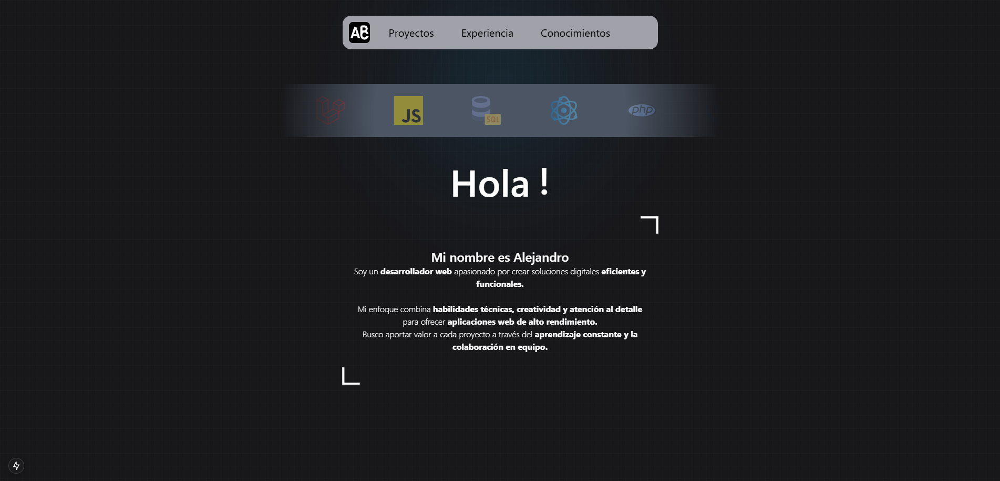

# Portfolio

Mi portafolio personal: quién soy, mis proyectos, mi experiencia y las tecnologías que uso.

**[portfolio-alexcb.vercel.app](https://portfolio-alexcb.vercel.app)**



## 🧩 Secciones

- **Inicio**: presentación y tecnologías principales.
- **Proyectos**: proyectos destacados (con capturas, tecnologías y enlaces) y, debajo, el resto de mis repositorios públicos, cargados con la API de GitHub.
- **Experiencia**: trayectoria profesional.
- **Conocimientos**: tecnologías agrupadas por área.

## 🚀 Tecnologías utilizadas

- [Next.js 15](https://nextjs.org/) (App Router) y [React 19](https://react.dev/)
- [TypeScript](https://www.typescriptlang.org/)
- [Tailwind CSS](https://tailwindcss.com/)
- [Framer Motion](https://motion.dev/) para las animaciones
- [next-themes](https://github.com/pacocoursey/next-themes) para el modo claro y oscuro
- [Sentry](https://sentry.io/) y Vercel Analytics / Speed Insights

## 📁 Estructura del proyecto

```
portfolio/
├── public/
│   └── images/            # Imagen para redes y capturas de los proyectos
├── src/app/
│   ├── components/        # Cabecera, slider, iconos y componentes de UI
│   ├── data/projects.ts   # Proyectos destacados
│   ├── pages/             # Proyectos, experiencia y conocimientos
│   ├── layout.tsx
│   └── page.tsx           # Inicio
└── next.config.ts         # Rutas en español (/proyectos, /experiencia, /conocimientos)
```

## ✏️ Añadir un proyecto destacado

Añade una entrada en `src/app/data/projects.ts` y, si tiene captura, guárdala en `public/images/proyectos/`. Los repositorios públicos que no estén destacados salen solos en «Más en GitHub» (sin forks).

## 📄 CV

El CV descargable está en `public/cv/Alejandro-Cruz-Ballestero-CV.pdf` y se genera desde `cv/cv.html`. Para actualizarlo, edita el HTML, ábrelo en Chrome e imprímelo como PDF (A4, sin márgenes y con «Gráficos de fondo» activado).

## 📦 Instalación y uso

```bash
git clone https://github.com/alecb6/portfolio.git
cd portfolio
npm install
npm run dev
```

Puedes contactarme a través de [LinkedIn](https://www.linkedin.com/in/alejandro-cruz-ballestero-347a87349/) o en cananpa2014.jr@gmail.com.
